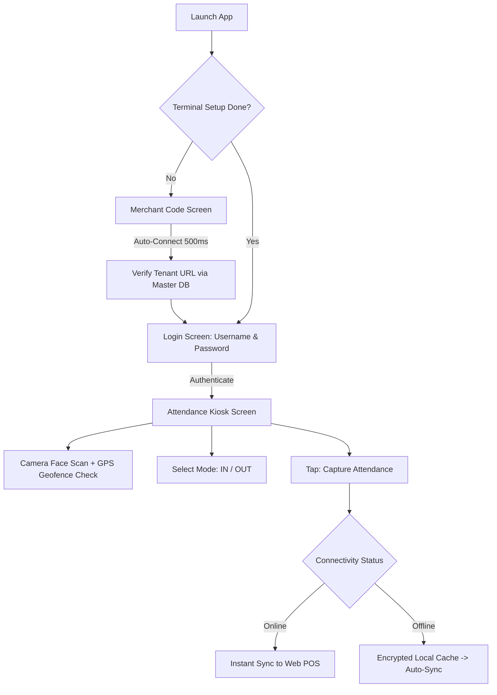

# 📱 ElintOm@ — Face Attendance Kiosk App Guide

Operational and technical documentation for the **ElintOm@** Android Face Recognition & Geofenced Attendance Terminal. All screens, buttons, and workflows below strictly match the actual app implementation.

---

## 📌 1. App Overview

**ElintOm@** is a dedicated Android attendance kiosk built with **Jetpack Compose**, **CameraX**, and **ML Face Detection**. It connects to the ElintOm Web POS backend (`attendance_api`) to provide automated, contactless staff attendance with real-time geofence validation.



### Core Features:
- **Exact Two-Step Onboarding**:
  1. `Merchant Code`: Auto-connects to merchant tenant domain.
  2. `Log in`: Secure staff / kiosk authentication with Username & Password.
- **Smart Face Guide HUD**: Real-time oval frame overlay with color feedback (Green = Face Detected, Red = Multiple Faces, Amber = Hold Still).
- **IN / OUT Toggle Cards**: Instant punch mode selection with clear visual indicators.
- **Dynamic 4-Language Switcher**: Dedicated `lang/` package supporting **English (`en`)**, **Marathi (`mr`)**, **Hindi (`hi`)**, and **Gujarati (`gu`)**.
- **Real-Time Geofencing**: Verifies GPS latitude & longitude against the store's warehouse radius via Haversine distance formula.
- **Offline Auto-Sync**: Attendance is saved locally on device when offline and automatically synced to the server when internet reconnects.

---

## 🚀 2. Terminal Setup & Login Screen

The initial screen displayed when the terminal is launched for the first time or after clearing app data.

### 2.1 Step 1: Merchant Code Setup
- **Screen**: Soft ambient off-white `#F7FAFB` canvas with decorative pastel teal shapes.
- **Field**: **`Merchant Code`** (placeholder: `e.g. LH02`).
- **Auto-Detection**: Input auto-capitalizes. As soon as a valid 4–64 character code is entered, the app automatically triggers setup after a 500ms debounce (`LaunchedEffect`).
- **Indicator**: Shows a circular progress loader with text **`Connecting to merchant...`**.
- **Error Handling**: If invalid or expired, a red banner displays the exact server error with a button to **`View Error Logs / तपशील पहा`**.

### 2.2 Step 2: Login Card
Once the merchant code is verified, the card transitions to the login form:
- **Field 1**: **`Username`** (placeholder: `Username or phone`, with Person icon).
- **Field 2**: **`Password`** (placeholder: `Password`, with Lock icon and password visibility toggle).
- **Primary Button**: **`Log in`** (Full-width rounded pill button, height 50dp, color `#006D77`).
- **Footer**: **`Powered by ElintOM`**.

---

## 📸 3. Attendance Kiosk Screen

The primary terminal interface where employees mark daily check-in and check-out.

### 3.1 Screen Components & Exact UI Names:

| UI Component | Type / Style | Exact Button / Label in App | Function |
| :--- | :--- | :--- | :--- |
| **Header Bar** | Soft teal gradient `#E2F6F8` | **`ElintOm@` Logo**, Site Name, Profile Avatar | Displays tenant branding. Long-pressing the logo opens Terminal Settings. Tapping profile opens Profile & Language dialog. |
| **Language Switcher** | Pill Chips | **`[ EN | MR | HI | GU ]`** | Switches all app strings immediately between English, Marathi, Hindi, and Gujarati. |
| **Face Guide HUD** | Oval Camera Overlay | **`Face detected`** / **`Face detected successfully`** | Live front camera feed. Oval turns green when a single face is aligned, red for multiple faces, amber for hold still. |
| **Location Selector** | Dropdown Menu | **`Main Warehouse`** | Allows selecting the registered warehouse / site if multiple locations exist. |
| **Punch Mode** | Two 48dp Pill Cards | **`IN`** (Login Icon) & **`OUT`** (Logout Icon) | Active card is highlighted in deep teal (`#006D77`) with bold white text. |
| **Notes Section** | Text Input Box | **`Notes`** | Optional input for punch notes (e.g., late arrival reason, field task). |
| **Bottom Action Bar** | 52dp Elevated Button | **`Capture Attendance`** | Main submission button. Changes dynamically to **`Scanning...`**, **`Submitting...`**, or **`Retake`**. If GPS is acquiring, shows spinner + **`Acquiring GPS location...`**. |

---

## 🌐 4. Language Architecture (`lang/` Package)

All translations and localized messages are organized cleanly in dedicated per-language folders under `com.example.lang`:

```
app/src/main/java/com/example/lang/
├── AppStrings.kt                       # Common interface defining all UI strings
├── LangManager.kt                      # Central resolver: LangManager.getStrings(lang)
├── english/EnglishStrings.kt           # English ("en")
├── marathi/MarathiStrings.kt           # Marathi ("mr")
├── hindi/HindiStrings.kt               # Hindi ("hi")
└── gujrati/GujratiStrings.kt           # Gujarati ("gu")
```

### Exact UI Text Reference Across Languages:

| Element / Key | English (`en`) | Marathi (`mr`) | Hindi (`hi`) | Gujarati (`gu`) |
| :--- | :--- | :--- | :--- | :--- |
| **IN Button** | `IN` | `IN` | `IN` | `IN` |
| **OUT Button** | `OUT` | `OUT` | `OUT` | `OUT` |
| **Capture Button** | `Capture Attendance` | `हजेरी नोंदवा` | `उपस्थिति दर्ज करें` | `હાજરી નોંધો` |
| **Face Detected** | `Face detected successfully` | `चेहरा यशस्वीपणे ओळखला` | `चेहरा सफलतापूर्वक पहचाना गया` | `ચહેરો સફળતાપૂર્વક ઓળખાયો` |
| **Multiple Faces** | `Multiple faces detected` | `एकापेक्षा जास्त चेहरे आढळले` | `एक से अधिक चेहरे मिले` | `એક કરતાં વધુ ચહેરા મળ્યા` |
| **Hold Still** | `Hold still` | `स्थिर राहा` | `स्थिर रहें` | `સ્થિર રહો` |
| **Geofence Breach** | `Outside site perimeter` | `परिसराबाहेर आहात` | `सीमा से बाहर हैं` | `પરિસરની બહાર છો` |

---

## 📍 5. Geofence Perimeter Validation

Every punch captures real-time high-accuracy device GPS coordinates (`latitude`, `longitude`):
1. The app and server calculate the **Haversine Distance** to the selected warehouse coordinates.
2. If the terminal is within the allowed radius (e.g. `50m` set in POS Warehouse settings):
   - Punch is accepted and recorded.
3. If the terminal is outside the radius:
   - Punch is rejected with alert: *"You are outside the registered office/site perimeter."*
   - Red status badge alerts the staff member.

---

## 💾 6. Offline Mode & Automatic Cloud Sync

When network connectivity is unavailable:
1. **Local Storage**: Punches are saved securely to encrypted local device storage with precise timestamps.
2. **Network Listener**: Android network callback monitors connection state.
3. **Auto-Flush**: When internet is restored, the queue automatically syncs to `/attendance_api/sync_offline`.
4. **Offline Status Bar**:
   - Status text: *"No internet. Check-in and check-out are saved on this phone and will sync when internet is back."*
   - Once back online: *"Internet is back. Sending saved attendance."*

---

## 🔌 7. Backend API Summary

| # | Endpoint | Method | Parameter Payload |
| :-: | :--- | :-: | :--- |
| **01** | `/attendance_api/init` | `GET` | Health check & system time |
| **02** | `/attendance_api/setup` | `POST` | `code`: Merchant setup code (e.g. `LH022`) |
| **03** | `/attendance_api/login` | `POST` | `username`: Mobile/Username, `password`: Password |
| **04** | `/attendance_api/captured` | `GET` | Headers: `Authorization: Bearer <token>` |
| **05** | `/attendance_api/store` | `POST` | `attendance_type` (`check_in`/`check_out`), `latitude`, `longitude`, `landmark`, `notes`, `token` |
| **06** | `/attendance_api/sync_offline` | `POST` | JSON array of queued attendance records |
| **07** | `/attendance_api/sync_logs` | `POST` | Device hardware, GPS, and error log entries |

---

## 🛠️ 8. Troubleshooting Guide

- **"Merchant Code was not found"**: Verify the merchant code created in the Super Admin or Web POS Settings.
- **"Face not recognized. Tap Retake."**: Ensure proper front lighting and face is centered inside the green oval guide.
- **"GPS location is not available / Turn on GPS"**: Go to Android Device Settings -> Location -> Turn ON "Use Location" and set accuracy to High.
- **"Device is not ready for connect please contact customer care"**: Attendance module is suspended or subscription plan is expired in Super Admin.
